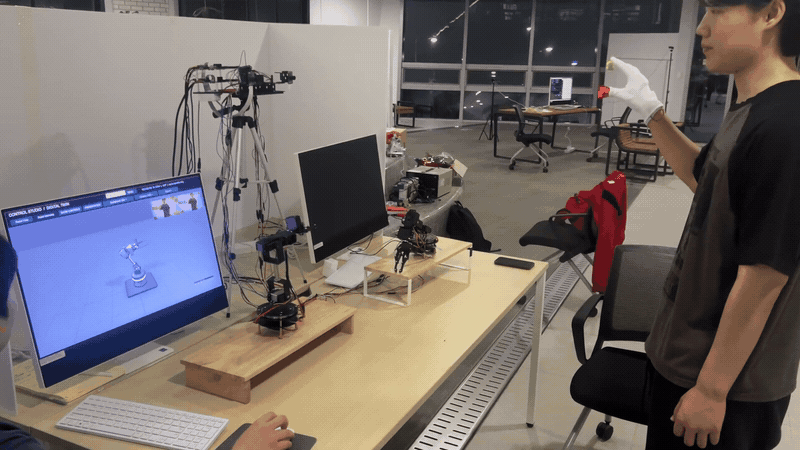
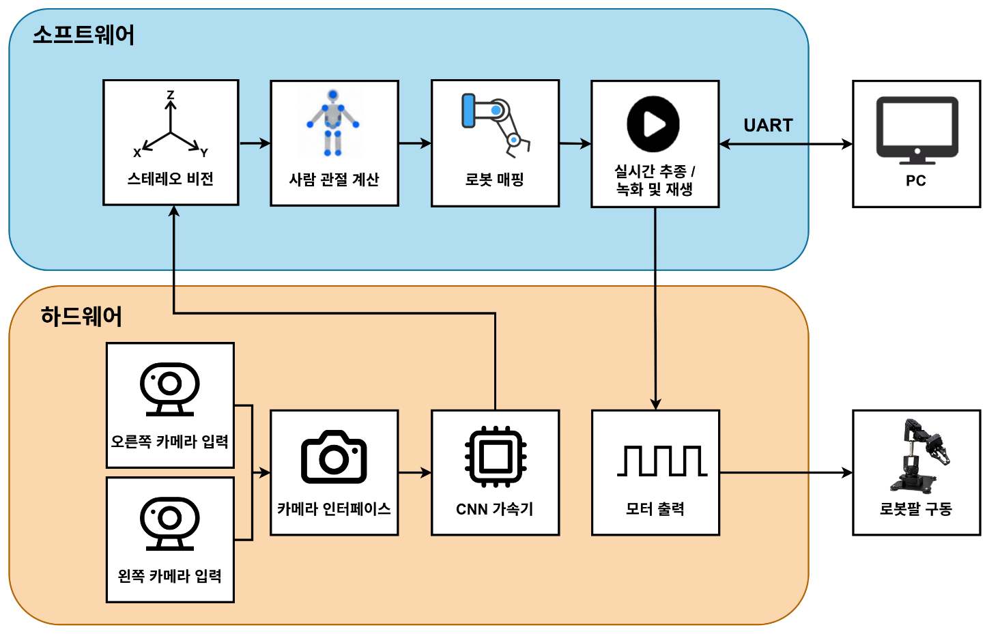
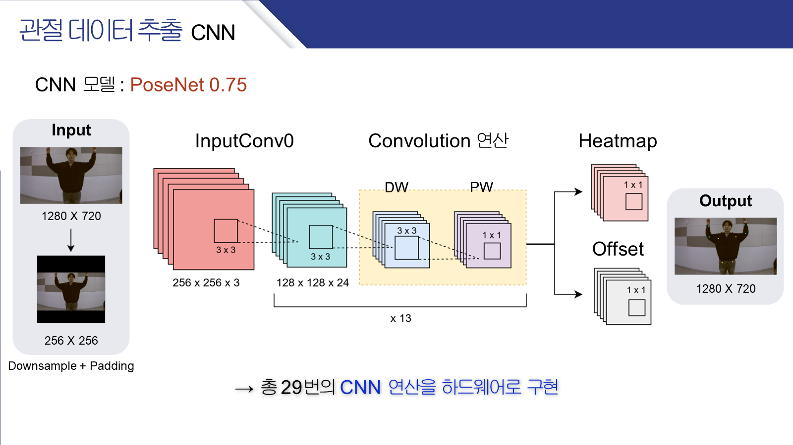
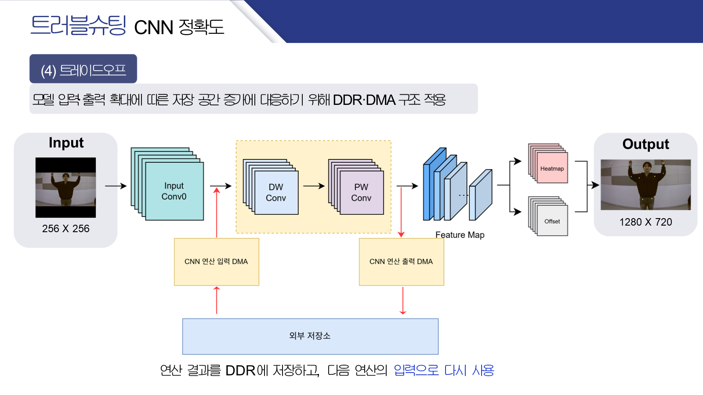
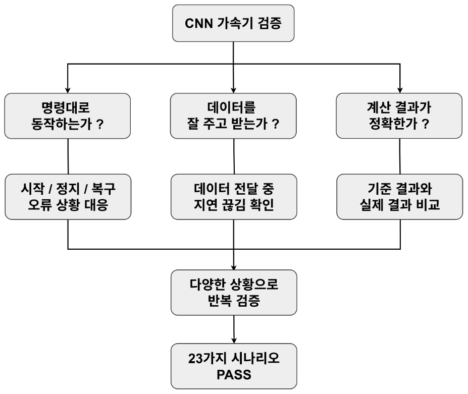
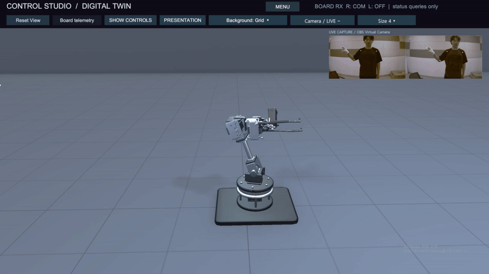
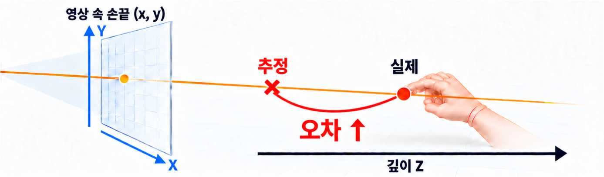

# Human Motion Control Platform

**움직임과 움직임을 잇다 — 움 이 움(움이움)**

발표명은 **CNN 모션인식 SoC 플랫폼**입니다. 사람의 움직임을 카메라로 관측하고, Zynq CNN Accelerator와 Embedded Firmware를 통해 로봇팔 제어 및 동작 데이터 수집으로 연결하는 팀 공동 프로젝트입니다. CNN RTL, SystemVerilog UVM, 5축 Robot Firmware와 Unity Digital Twin의 전체 소스를 함께 관리합니다.

## 1. 최종 시연 (Demo)



*최종 발표자료 10페이지의 원본 GIF, 150 frames / 6초. 사람의 팔·손 움직임과 실제 로봇팔, PC 가상 로봇 화면을 함께 보여줍니다.* 이 영상은 발표 당시 구성의 시연 기록입니다. 현재 통합 소스의 실제 보드 재검증은 별도이며, 향후 학습 데이터 활용·자동화 확장은 이번 시연의 검증 범위에 포함하지 않습니다.

> **통합 상태:** 소스 통합과 부분 검증을 완료했습니다. RTL/Firmware 식별자·RGBY Register Map, XSA·BOOT 대응 등은 미해결 상태입니다. [실행 검증 요약](VALIDATION_SUMMARY.md)과 [Integration Blockers](INTEGRATION_BLOCKERS.md)에 PASS / FAIL / NOT RUN / BLOCKED를 구분했습니다.

[System Architecture](#2-system-architecture) · [CNN RTL](#3-cnn-rtl-accelerator) · [UVM 검증](#4-systemverilog-uvm-verification) · [Firmware](#5-robot-arm-firmware) · [Unity](#6-unity-digital-twin) · [실행 방법](#9-development-environment--how-to-run) · [Team](#10-team--contributions)

## 2. System Architecture



*출처: 최종 발표자료 12페이지. 위 그림은 발표의 개념도이며, 아래 표는 최신 소스의 처리·통신 경로를 보완합니다.*

`Camera Input → CNN RTL Accelerator → Embedded Firmware → Robot Arm / Unity`가 프로젝트의 큰 흐름입니다. 실제 구현은 영상, DMA, 좌우 보드 통신, 모터 제어와 PC Telemetry를 나누어 처리합니다.

| 구간 | 구현과 데이터 흐름 |
|---|---|
| Camera / FPGA PL | Pcam 5C / OV5640 카메라 영상, MIPI·영상 처리와 VDMA/DDR 경로를 사용합니다. CNN은 영상·가중치·Feature Map을 AXI-Stream으로 수신합니다 |
| CNN / DDR | `cnn_accelerator_top`이 CNN 연산을 제어합니다. AXI4-Lite 제어, DMA 명령과 Feature Map의 DDR 읽기·쓰기를 스트림 데이터 경로와 구분합니다 |
| Zynq PS Firmware | CNN 관절·마커 관측을 받아 Stereo 3D 복원, 사람 팔 목표 계산, 로봇별 Joint Mapping·Calibration·Safety Control을 수행합니다 |
| RIGHT / LEFT | 보드 간 UART0로 관측·목표 데이터를 전달합니다. RIGHT는 로봇0, LEFT는 로봇1을 맡으며 각 보드에서 제어·보정을 수행합니다 |
| Robot Arm | 20 ms 제어 틱에서 속도·가속도를 제한한 서보 명령을 PWM Driver로 출력합니다 |
| PC / Unity | 콘솔 UART1의 TK Telemetry를 수신해 관절·상태를 표시합니다. 사용자 UI 명령과 CSV Replay는 별도 입력 경로입니다 |

카메라 픽셀을 UART로 Unity에 전송하는 구조는 아닙니다. PC 영상 Preview와 UART 관절 Telemetry를 구분하며, **TK는 서보 명령 데이터**입니다. 실제 엔코더 위치·힘·온도 피드백을 뜻하지 않습니다.

## 3. CNN RTL Accelerator



*출처: 최종 발표자료 26페이지 원본 슬라이드. 개별 이미지와 텍스트가 결합된 구조를 PowerPoint에서 그대로 내보냈습니다.*

PoseNet 0.75 기반의 관절 추출을 위한 정수 연산 구조입니다. 1280×720 영상의 Downsample·Padding으로 256×256 입력을 구성하고, manifest의 29개 연산과 Heatmap / Offset 후처리를 통해 17개 신체 관절을 다룹니다. Color Marker 경로는 손가락 위치 관측을 보완하며 전체 손 관절 추정을 의미하지 않습니다.

| 설계 영역 | 주요 RTL 모듈과 역할 |
|---|---|
| 전처리 / Input Convolution | `downsample_module`, `input_conv_pe`, `line_buffer`: 입력 정규화·Padding·초기 Convolution과 Window 공급 |
| Depthwise Convolution | `depthwise_conv_pe`: 채널별 3×3 공간 연산과 정수 누산·재양자화 |
| Pointwise Convolution | `pointwise_conv_pe`: 1×1 채널 결합 연산과 Feature 출력 |
| Feature Map / Weight | `feature_map_io`, `weight_bram_swap_fsm`: Feature 입출력과 가중치 공급·저장소 전환 |
| 연산 제어 | `top_level_fsm`, `layer_param_rom`: 단계 진행, DMA 제어 요청과 연산 Descriptor |
| 후처리 / Marker | `argmax_offset_select`, `coord_restore`, `color_marker_detect`: 좌표 선택·복원 및 마커 검출 |
| 통합 / AXI4-Lite | `cnn_accelerator_top`: 외부 제어·상태 Register, 스트림과 IRQ 통합 |



*출처: 최종 발표자료 43페이지. Feature Map 저장 공간 확대에 대응한 DDR·DMA 구조입니다.*

`CNN/rtl/`에는 top과 12개 하위 설계 모듈이 있습니다. 상세 인터페이스는 [모듈 설계 문서](CNN/docs/docs/), 수치 기준과 가중치는 [Golden Model](CNN/golden_py_model/)에 있습니다. 설계 문서의 자원·시간 예산은 실제 합성 사용량이나 실측 FPS로 해석하지 않습니다.

## 4. SystemVerilog UVM Verification



*출처: 최종 발표자료 27페이지. 그림의 “23가지 시나리오 PASS”는 발표 당시 보고입니다. 해당 수치나 Coverage를 현재 통합 소스의 재실행 결과로 사용하지 않습니다. 원본 그림의 문구는 수정하지 않았습니다.*

외부 `cnn_accelerator_top` 인터페이스에 AXI4-Lite Agent, AXI-Stream Driver/Monitor, Scoreboard와 시나리오별 Sequence를 구성했습니다. 검증 범위는 다음과 같이 나눕니다.

| 영역 | 검증 소스의 목적 | 이번 통합 후보에서 확인한 결과 |
|---|---|---|
| Golden Model Verification | Python Golden과 관절·연산 출력 비교, Threshold·Multi-frame·Atomic Publish·Stall/Random 시나리오 | UVM compile/elaboration **PASS**. 전체 회귀는 expected/input 누락으로 **BLOCKED** |
| Control Verification | Register 접근, AXI4-Lite 순서·응답, START 정책·설정 Snapshot·Fault/Recovery | XSim 2020.2에서 `checker` 식별자 compile **FAIL**, 회귀 **BLOCKED** |
| DMA / AXI-Stream Verification | DMA Command/주소/길이, VALID/READY·KEEP/LAST, Backpressure, 연산 단계별 데이터 전달 | compile **PASS**, XSim 내부 오류로 elaboration **FAIL**, 회귀 **BLOCKED** |
| Common UVM Base | 공통 Agent·환경·기본 Test 초기화 | `cnn_base_test` **PASS**, UVM_ERROR=0 / UVM_FATAL=0. time 0 초기화 smoke 범위 |

DMA Responder는 제어·상태 동작을 모델링하며 실제 Xilinx DMA·DDR 하드웨어 전체 모델은 아닙니다. XSim은 일부 Cover 및 Random 기능에 제약이 있어 VCS/Verdi 회귀·Coverage 승인과 구분합니다. [공통 환경](README_CNN_UVM_BASE.md), [DMA 검증 설명](CNN/uvm/dma_stream/README.md), [실행 증거](validation/step3/STEP3_RESULTS.json)를 참고하세요.

### 주요 검증 결과

2026-10-19, STEP 2 source commit `b7eb63cb6b79a5b22a6e6b6e9fceb70eec67aa46`를 기준으로 실행했습니다.

| 대상 | 결과 | 확인 범위 |
|---|---|---|
| 원본 RTL / Directed TB | 전체 Verilog compile **PASS**. 16개 TB 중 **12 PASS / 3 FAIL / 1 BLOCKED** | argmax 모듈명 차이, Color Marker 검사 실패, Feature Map TB timeout, 입력 벡터 누락 유지 |
| Packed Python Golden | **PASS** | Python 3.10 / NumPy 1.24.4, frame 121~125의 기존 관절 결과 동일, Heatmap·Offset 원소 차이 0 |
| ZIP Golden | **FAIL** | Archive hash mismatch 재현. Packed 성공과 별개 |
| Firmware RIGHT / LEFT | HSI BSP + Vitis ARM GCC compile/link **PASS** | 역할별 C 72개, compiler warning 0. 표준 Vitis IDE 연결 스크립트 경로는 **BLOCKED** |
| Unity 6000.3.24f1 | Import / Windows x64 Build **PASS** | Demo_07, Development OFF, 오류 0·경고 4 |
| Unity 오프라인 검증 | **PASS** | Player 7개 fixture 2793개 + C# 43개 = **2836개 검사**. C#은 .NET 10 명시적 roll-forward 실행 |
| Native DLL | 로딩·읽기 전용 ABI/role 조회 **PASS** | RIGHT ABI3/role2, LEFT ABI3/role1, XYZ ABI1. 최신 Firmware로의 재빌드 재현성 **BLOCKED** |
| 실제 UART / FPGA / Robot | **NOT RUN** | 이번 통합 검증에서 실제 송신·FPGA 프로그램·서보 구동을 수행하지 않음 |

Packed Golden 자체의 일치는 전체 CNN RTL과의 bit-exact 일치를 증명하지 않습니다. VCS/Verdi 원본 회귀와 외부 SingleRole CSV 옵션은 **NOT RUN**입니다. 세부 조건·로그·ELF hash는 [VALIDATION_SUMMARY.md](VALIDATION_SUMMARY.md)에 기록했습니다.

## 5. Robot Arm Firmware

최신 `dev/integration`의 `robot_arm/`을 기준으로 통합했습니다. Unity 브랜치에 있던 과거 Firmware 사본을 혼합하지 않았습니다. 현재 제어축은 **elbow roll → elbow pitch → wrist pitch → wrist roll → gripper의 5축**입니다.

| 기능 | 최신 구현의 역할 |
|---|---|
| Pose Data Processing | Camera/CNN 관측에서 유효한 관절·마커 데이터를 선택하고 사람 팔 목표로 변환 |
| Stereo / Motion Control | 좌우 관측의 3D 복원·필터링과 RIGHT/LEFT 목표 전달, 관측 갱신과 50 Hz 제어 분리 |
| Joint Mapping & Calibration | 로봇별 방향·Offset·가동 범위, FK 기반 승인 목표와 기구별 보정 |
| UART Communication | UART0 보드 간 통신, UART1 콘솔·Unity 명령과 A1/A2/P3/TK Telemetry |
| Servo PWM / Safety Control | 출력 허가, Joint Limit·속도/가속도 제한, PWM 변환. 부팅 시 로봇 PWM OFF |
| Record & Replay | 최종 서보 명령 샘플 녹화, SD 저장·선택·삭제·재생. 재생 시 사람 각도 보정을 중복 적용하지 않음 |

발표 시연의 기구 외형과 Unity의 가상 모델을 현재 펌웨어 제어축 수와 혼동하지 않습니다. 로봇별 치수·그리퍼 한계 및 실제 설치 BOOT의 일치는 별도 확인 대상입니다. 상세 소스·역할·빌드는 [Firmware README](robot_arm/README.md)를 따릅니다.

## 6. Unity Digital Twin



*출처: 최종 발표자료 35페이지 원본 GIF, 150 frames / 6초. 발표 당시 UI·동작 기록이며 현재 Import/Build 판정은 위 검증 표를 따릅니다.*

`dev/unity`의 전체 Unity 프로젝트를 포함합니다. Unity **6000.3.24f1**에서 `Demo_07_SingleArmControl` Scene과 Windows x64 Native DLL을 사용합니다.

- **Virtual Robot Arm:** G51/Humanoid 표시 모델, 관절 Transform과 RIGHT/LEFT/BOTH 선택.
- **UART 수신:** TK 17필드 파싱, 포트·역할별 데이터 선택과 상태 표시. Firmware의 A1/A2/P3 전체를 현재 Unity 런타임이 파싱하는 것은 아닙니다.
- **Control UI:** Startup Menu, Ports/Control, Quick HUD, SD Records, Camera Overlay Toggle과 응답 확인.
- **CSV Replay:** 입력 파일 선택, 역할 확인, PLAY/PAUSE/RESUME/STOP. CSV 입력과 UART 입력의 소유권을 분리합니다.
- **Native DLL:** 기존 Robot 변환/검증 경로를 유지합니다. 과거 Robot revision에 의존하는 재빌드 스크립트는 최신 Firmware 재현성을 보장하지 않습니다.

CSV 관절값의 PC→FPGA 실시간 스트리밍은 구현 범위에 포함하지 않습니다. 가상 표시만으로 물리 모터의 상태나 차단 여부를 보증하지 않습니다. 실행·빌드는 [Unity README](Unity/README.md)를 참고하세요.

## 7. Troubleshooting

발표자료 39~51페이지의 문제 분석과 해결 방향을 최신 소스에서 확인한 구조에 연결했습니다. 발표 당시 개선과 이번 통합 후보의 재검증 결과를 구분합니다.

| 사례 | 문제 → 원인 분석 | 해결 방법 | 검증 결과와 한계 |
|---|---|---|---|
| CNN 입력 정보 손실 (39~44p) | PoseNet 0.50 / 128×128에서 관절 추정 불안정 → 모델 표현력·해상도에 따른 정보 손실을 원인으로 추정 | 모델·해상도 조합을 비교하고 PoseNet 0.75 / 256×256 선택 | 발표자료에 선택 과정·시연 결과가 있음. 현재 Packed Golden 5개 입력 일치 확인. GT 정확도·처리 시간은 이번 단계에서 재측정하지 않음 |
| Feature Map 저장 공간 (41~43p) | 모델 입력·출력 확대 → FPGA 내부 저장 공간 부담 증가 | 연산 결과를 외부 DDR에 저장하고 AXI DMA로 다음 연산에 재사용 | 현재 Feature Map TB는 원본 2ms timeout으로 FAIL. 전체 DMA UVM 회귀는 도구 오류로 BLOCKED |
| 로봇 회전 방향 불일치 (48~51p) | 사람과 로봇의 회전 방향이 어긋남 → 단안 상대 좌표 재구성의 깊이 오차·각도 왜곡 분석 | Stereo Vision으로 카메라 기준 절대 3D 좌표를 복원하고 관절 목표로 변환 | 발표자료에 개선 동작 시연. 최신 소스의 Stereo 처리·역할별 ELF 빌드 확인. 물리 오차·보정 재검증은 NOT RUN |



*출처: 최종 발표자료 49페이지. Stereo 도입 전 깊이 오차의 원인 분석입니다.*

현재 남은 통합 문제는 [INTEGRATION_BLOCKERS.md](INTEGRATION_BLOCKERS.md)에서 관리합니다. 특히 VERSION / FEATURES / PACK_ID와 Yellow Register 차이는 이번 문서 정리에서 수정하지 않았습니다.

## 8. Repository Structure

```text
CNN/
├── rtl/                # CNN top·연산 모듈·제약
├── tb/                 # Directed Testbench
├── golden_py_model/    # 정수 Golden·가중치·입력·기준 출력
├── uvm/                # Common / Golden / Control / DMA-Stream
└── docs/               # 모듈 설계·인터페이스 문서
robot_arm/              # 최신 RIGHT/LEFT Firmware·Driver·Vitis 자료
Unity/                  # 전체 Unity 프로젝트·Native DLL·PC 검증 도구
docs/media/             # 발표 원본 GIF·이미지·슬라이드 출처
validation/step3/       # 통합 후보의 실행 결과·로그 발췌·정적 audit
```

[원본 출처·SHA·Git tree 기록](MAIN_INTEGRATION_SOURCES.json) · [Firmware](robot_arm/README.md) · [Unity](Unity/README.md) · [UVM Base](README_CNN_UVM_BASE.md) · [미디어 출처·용량](docs/media/SOURCES.md)

## 9. Development Environment & How to Run

| 영역 | 환경 / 기술 | 별도 의존성 |
|---|---|---|
| FPGA / RTL | Zybo Z7-20 / XC7Z020, Verilog, AXI4-Lite, AXI-Stream, DDR·DMA, Vivado / XSim 2020.2 | 사용 IP·합성 환경에 필요한 라이선스와 일치하는 Hardware Design |
| Camera / Robot | Pcam 5C / OV5640 좌우 관측, 5축 Servo Robot Arm | 카메라 보정·배선·로봇별 기구 설정, 현재 XSA·설치 BOOT 대응 확인 |
| UVM | SystemVerilog, UVM 1.2, 원본 VCS / Verdi 흐름 | 해당 도구·라이선스, 누락 실행기·Golden expected·입력 벡터 |
| Golden | Python 3.10, NumPy 1.24.4 | 추적된 Packed Weight·manifest·이미지. ZIP archive hash 문제 별도 |
| Firmware | C, Vitis 2020.2, ARM GCC, Standalone BSP, xilffs | `final_uart0.xsa`, custom driver, SD의 `WGT_V4.BIN` / `WGT_V4.SHA` |
| Digital Twin | Unity 6000.3.24f1, C#, Windows x64 Native DLL / C ABI | Windows x64 Build Support, 최초 패키지 다운로드·Git, 실제 연결 시 일치하는 UART 계약 |

### Golden 실행

저장소 루트에서 격리 환경을 만들고, 기준 자료를 덮어쓰지 않는 새 출력 폴더를 사용합니다.

```powershell
$python310 = "$env:LOCALAPPDATA/Programs/Python/Python310/python.exe" # 설치 위치에 맞게 지정
& $python310 -m venv .validation/venv
.validation/venv/Scripts/python.exe -m pip install -r CNN/golden_py_model/requirements.txt
.validation/venv/Scripts/python.exe -B CNN/golden_py_model/cnn_model_v4.py run --packed CNN/golden_py_model/generated/weights_v4.bin --manifest CNN/golden_py_model/generated/manifest.json --image CNN/golden_py_model/images_npy/frame_00121.npy --out .validation/golden/frame_00121
```

Packed 경로가 이번 검증에서 성공한 경로입니다. `weights_export.zip` 입력은 hash mismatch로 FAIL이며, hash나 기준 결과를 임의 변경하지 않습니다.

### RTL Directed TB / UVM

다음은 PASS한 `tb_pointwise_conv_pe_fault`를 실행하는 XSim 예입니다. Vivado 설치 경로를 환경에 맞게 지정하고 매 단계 exit code와 로그의 정상 완료 marker를 함께 확인합니다. 중간 PASS 문자열이나 exit 0만으로 통과 처리하지 않습니다.

```powershell
$vivado = 'C:/Xilinx/Vivado/2020.2/bin'
$rtl = @(Get-ChildItem CNN/rtl/*.v, CNN/tb/*.v | ForEach-Object FullName)
$rtlInclude = (Resolve-Path CNN/rtl).Path
New-Item -ItemType Directory .validation/rtl_example_pointwise -ErrorAction Stop | Out-Null
Push-Location .validation/rtl_example_pointwise
try {
    & "$vivado/xvlog.bat" -i $rtlInclude @rtl
    if ($LASTEXITCODE) { throw 'xvlog failed' }
    & "$vivado/xelab.bat" --debug typical --mt 2 -s tb_pointwise_conv_pe_fault work.tb_pointwise_conv_pe_fault
    if ($LASTEXITCODE) { throw 'xelab failed' }
    & "$vivado/xsim.bat" tb_pointwise_conv_pe_fault -runall
    if ($LASTEXITCODE) { throw 'xsim failed' }
} finally { Pop-Location }
```

UVM의 `files.f`, `golden/files_golden.f`, `dma_stream/files_dma_stream.f`는 저장소 루트, `control/files_ctrl.f`는 `CNN/uvm/control/` 기준입니다. 실행 argv와 XSim의 기본 `1ns/1ps`·UVM 1.2 설정은 [검증 실행 기록](validation/step3/STEP3_RESULTS.json)에 있습니다. `cnn_base_pkg.sv`가 include하는 Class를 중복 컴파일하지 않습니다.

Golden 실행기는 `CNN/uvm/golden/golden_io/`에 있습니다. DMA README가 안내하는 `scripts/`와 일부 expected·입력 파일은 Git 원본에 없어 전체 회귀를 그대로 재현할 수 없습니다. 누락 목록은 [B05](INTEGRATION_BLOCKERS.md#b05--uvm-실행기입력-벡터-누락-blocked)를 참고하세요.

### Firmware 빌드

PowerShell 7과 Vitis 2020.2에서 **새롭고 짧은 외부 workspace**를 사용합니다.

```powershell
pwsh -NoProfile -File robot_arm/vitis/setup_vitis.ps1 -Workspace D:/vws/new_right -StereoRole Right
pwsh -NoProfile -File robot_arm/vitis/setup_vitis.ps1 -Workspace D:/vws/new_left -StereoRole Left
```

이번 환경에서 위 표준 스크립트는 Vitis IDE 연결 timeout으로 BLOCKED였습니다. 대체 HSI BSP 생성·ARM GCC 직접 빌드는 RIGHT/LEFT 모두 성공했으며, [실행 명령·산출물 hash](validation/step3/STEP3_RESULTS.json)와 [빌드 근거](VALIDATION_SUMMARY.md#firmware-빌드-근거)를 기록했습니다. ELF 빌드 성공은 현재 RTL·XSA·BOOT·SD 가중치의 호환성 승인이 아닙니다.

### Unity Import / Build / 오프라인 검증

Unity Hub에 저장소의 `Unity/` 폴더를 추가하고 **6000.3.24f1**로 엽니다. `Assets/Scenes/Demo_07_SingleArmControl.unity`가 유일한 enabled Scene이며 Windows x64, Development Build OFF를 사용합니다.

```powershell
$unityExe = 'D:/Unity/Hub/Editor/6000.3.24f1/Editor/Unity.exe' # 설치 위치에 맞게 지정
$projectDir = (Resolve-Path Unity).Path
$playerPath = (Join-Path (Get-Location) '.validation/unity_new/HumanMotionDigitalTwin.exe')
& $unityExe -batchmode -nographics -quit -projectPath $projectDir -executeMethod CameraPreviewSizeBatch.BuildLatest --camera-player-output $playerPath -logFile "$env:TEMP/HumanMotion-build.log"
pwsh -NoProfile -File Unity/Tools/ShareValidation/Invoke-PlayerChecks.ps1 -PlayerExe $playerPath -OutputDirectory .validation/player_checks_new
```

동일 프로젝트의 Editor를 닫고 새로운 출력 폴더를 지정합니다. 빌드 후 로그와 실제 Player 생성 여부를 먼저 확인하고 검증 스크립트를 실행하세요. 외부 SingleRole CSV는 선택 입력이며 기본 7개 fixture에 포함하지 않습니다. EXE 전달 시 `_Data`, `UnityPlayer.dll`, `MonoBleedingEdge`, Plugins를 포함한 빌드 폴더 전체가 필요합니다.

## 10. Team & Contributions

**움이움은 CNN Team과 Robot Team이 함께 설계·구현·검증·통합한 공동 프로젝트입니다.** 아래 개인별 담당은 발표자료 2페이지의 분담표를 기준으로 작성했습니다. 시스템 시연과 전체 통합 성과는 팀 공동 결과입니다.

| 팀 | 팀원 | 발표자료에 명시된 담당 |
|---|---|---|
| CNN | 이영현 (팀장) | CNN 사양 설계·모델 추가 학습, 모듈 검토·전체 시스템 통합 |
| CNN | 유지민 | CNN 전처리, IMAGE DMA 설계, DMA/Stream UVM 검증 |
| CNN | 조정민 | CNN 후처리, Feature Map DMA 설계, Control·Register UVM 검증 |
| CNN | 한승훈 | CNN Convolution 설계, AXI4-Lite Peripheral 연동, UVM 검증·가상 환경 구축 |
| Robot | 지승배 | 로봇팔 제어 로직, Firmware 통합 |
| Robot | 이민 | Stereo Vision 기반 3D 좌표 구현, 로봇팔 제어 관절각 산출 |
| Robot | 이승열 | 5축 Servo PWM 출력, Record/Replay, 가상 환경 구축 |

모듈별 초기 배정은 [설계 인계 문서](CNN/golden_py_model/CNN_v4_README.md#구현-담당과-읽는-순서), 실제 변경 이력은 [Contributors / commit 이력](https://github.com/realisshoon/zynq-cnn-motion-robot-soc/graphs/contributors)과 [원본 이력 audit](validation/step3/STEP3_HISTORY.json)에서 확인할 수 있습니다. 초기 문서의 `argmax_threshold` 표기와 현재 RTL `argmax_offset_select` 차이는 검증 Blocker에 기록했습니다. 실명과 GitHub 계정의 확인되지 않은 매핑은 프로필 링크로 추정하지 않았습니다.

## 11. 자료 출처와 통합 기준

시각 자료는 팀 최종 발표 PPT에서 추출했습니다. 새 구조도·가상 검증 화면을 생성하지 않았으며, GIF의 Frame·Timing·Loop를 원본 그대로 보존했습니다. [미디어 목록](docs/media/SOURCES.md)에 슬라이드 번호, 파일 크기, 추출 방식과 최적화 여부를 기록했고 [MEDIA_SOURCES.json](docs/media/MEDIA_SOURCES.json)에 SHA256을 제공합니다.

소스는 `dev/cnn`, `val/cnn/integration`, `dev/integration`, `dev/unity`의 확정 SHA에서 선택 통합했습니다. 약 1.10 GB의 소스·데이터를 보존했으며, cache 2개와 compiler stderr 1개만 디스크에 남긴 채 추적 해제했습니다. Golden·DLL·XSA·BOOT·입력 데이터를 광범위하게 제외하지 않았습니다.

현재 main 조상 관계에는 원본 팀원 이력이 모두 연결되어 있지 않습니다. 기존 commit을 재작성하지 않는 후속 이력 연결 방안과 GitHub merge 방식은 [Git 이력 분석](VALIDATION_SUMMARY.md#git-이력-보존-분석과-권고)에 정리했습니다. 이 저장소의 현재 문서는 소스 통합·검토의 기준이며, 실제 시스템 릴리스는 미해결 항목의 확인 후 판정합니다.
